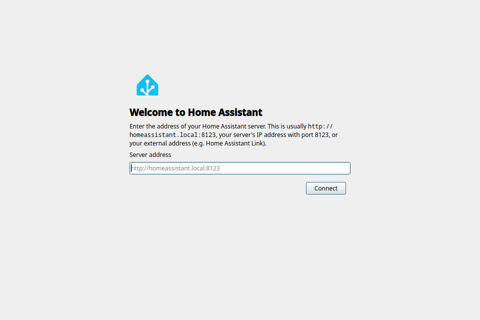
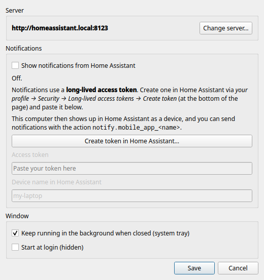

<div align="center">


# Home Assistant for Linux

[🇳🇱 Nederlands](README.md) · **🇬🇧 English**

**Your Home Assistant dashboard as a real desktop app — with notifications on your desktop.**

[](../../releases/latest)




</div>

---

## ✨ Features

| | |
|---|---|
| 🏠 **Its own window** | The full Home Assistant interface, without browser tabs or an address bar. |
| 🚀 **Easy setup** | Enter your server address; the app checks that Home Assistant is really running there. |
| 🔐 **Stays logged in** | Log in once, even across restarts. |
| 🔔 **Notifications** | Send notifications from automations to your PC, just like to your phone. Click one and the right page opens. |
| 📥 **System tray** | Keeps running in the background so you don't miss a notification. Can start at login. |
| 🔒 **Local and secure** | Notifications come straight from your own server, not through a cloud. Your token is stored in the keyring (KWallet / GNOME Keyring). |
| 🔁 **Robust** | Server briefly down or laptop waking from sleep? The app reconnects by itself. |
| 🌍 **English and Dutch** | Follows your system language. |

## 📦 Install

1. Download the latest `.rpm` file from **[Releases](../../releases/latest)**.
2. Install it:
   ```sh
   sudo dnf install ./ha-desktop-*.noarch.rpm
   ```
3. Start **Home Assistant** from the menu.

Uninstall: `sudo dnf remove ha-desktop`

<details>
<summary><b>Not on Fedora 44?</b> Install from source</summary>

<br>

You need Python 3 and PySide6 with QtWebEngine (Fedora: `python3-pyside6`,
Arch: `pyside6`, Debian/Ubuntu: the `python3-pyside6.*` packages or `pip install PySide6`).

```sh
git clone https://github.com/Svenvdp21/ha-desktop.git
cd ha-desktop
./install.sh            # adds the app to your menu
./install.sh --remove   # remove it again
```

Keep the folder afterwards: the app runs from it.
</details>

## 🚀 First run

1. Enter your server address, for example `http://homeassistant.local:8123` or your
   Home Assistant Link address. If you use a self-signed certificate, the app asks
   whether you want to trust it.
2. Log in as usual. Tick **Keep me logged in**.
3. Want notifications? Follow the steps below, or choose *Skip* and do it later.

## 🔔 Setting up notifications



Notifications use a **token**: a kind of password the app uses to talk to your server
on its own.

1. Open the settings in the app (`Ctrl+,`) and click
   **Create token in Home Assistant…**
2. Scroll **all the way down** to *Long-lived access tokens* and click
   **Create token**.
3. Copy the token right away (you only see it once), paste it into the app and click
   **Save**.

Your PC is now a device in Home Assistant. Send a notification with:

```yaml
action: notify.mobile_app_my_laptop   # your device name
data:
  title: Doorbell
  message: Someone is at the door
  data:
    url: /lovelace/cameras   # optional: opens when clicked
```

<br clear="right">

## ⌨️ Keyboard shortcuts

| Key | Action |
|---|---|
| `F5` / `Ctrl+R` | Reload |
| `Alt+←` / `Alt+→` | Back / forward |
| `Alt+Home` | Home page |
| `F11` | Full screen |
| `Ctrl +` / `Ctrl -` / `Ctrl 0` | Zoom |
| `Ctrl+,` | Settings |
| `Ctrl+Q` | Quit (closing the window keeps the app running in the system tray) |

Settings are also available from the right-click menu and the system tray.

## ❓ Troubleshooting

<details>
<summary><b>"Can't connect to Home Assistant"</b></summary>

Check that the address is correct and that your server is running. The app retries every
10 seconds. Does the address work in your browser? Choose *Settings → Change server…* and
enter it again.
</details>

<details>
<summary><b>I'm not getting notifications</b></summary>

- Check the settings: it should say **● Connected**.
- The app must be running (the system tray is enough).
- Does it say *rejected the token*? Create a new token and paste it again.
- In Home Assistant, check under *Settings → Devices → Mobile App* that your PC is listed.
</details>

<details>
<summary><b>I keep having to log in</b></summary>

Tick **Keep me logged in** on the login page.
</details>

<details>
<summary><b>Using the app in another language</b></summary>

The app follows your system language: Dutch on a Dutch system, English otherwise.
To force a language, start it with `HA_DESKTOP_LANG=en ha-desktop` (or `nl`).
</details>

<details>
<summary><b>Where is my data stored?</b></summary>

| What | Where |
|-----|------|
| Settings | `~/.config/ha-desktop/config.json` |
| Token | Keyring, or otherwise `~/.config/ha-desktop/token` (readable only by you) |
| Login and cookies | `~/.local/share/ha-desktop/webengine` |
| Cache | `~/.cache/ha-desktop` |
</details>

## 🛠️ For developers

```sh
python3 -m ha_desktop --debug                                       # run from source
QT_QPA_PLATFORM=offscreen python3 -m unittest discover -s tests -v  # tests
./packaging/build-rpm.sh                                            # build RPM -> dist/
```

UI text in the code is English and wrapped in `_("...")`; the Dutch translation lives in
`ha_desktop/translations.py`. The tests check that every string has a translation.

The tests run against a simulated Home Assistant (`tests/fake_ha.py`): server check,
device registration, the push channel and reconnecting.

Releasing a new version: bump `__version__` in `ha_desktop/__init__.py`, build the RPM and
create a release. Existing installs update with `sudo dnf install` of the new RPM.

The notification protocol (`mobile_app` registration with `push_websocket_channel`)
follows the same approach as [go-hass-agent](https://github.com/joshuar/go-hass-agent). Want
sensors from your PC in Home Assistant too (CPU, battery, …)? You can run go-hass-agent
alongside; just enable notifications in only one of the two.

---

<sub>This is not an official Home Assistant project. The name and logo are trademarks of the
[Open Home Foundation](https://www.openhomefoundation.org/) and are used here for private,
non-commercial use only.</sub>
