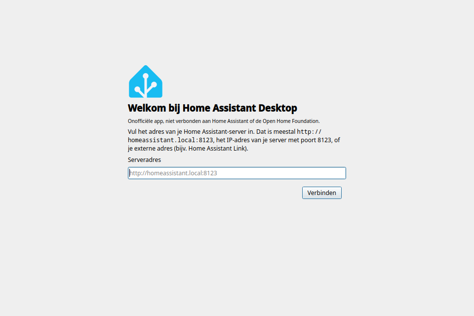
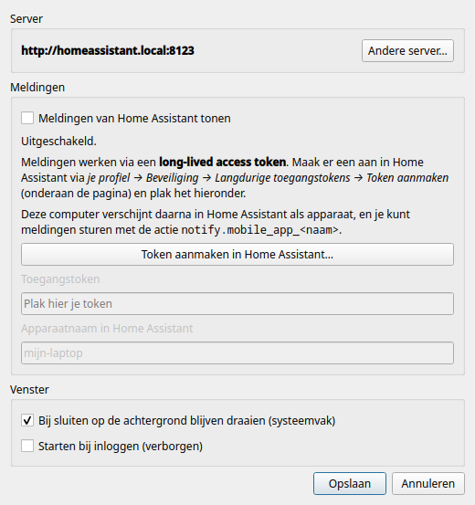

<div align="center">


# Home Assistant Desktop

*Onofficiële Home Assistant-app voor Linux*

**🇳🇱 Nederlands** · [🇬🇧 English](README.en.md)

**Je Home Assistant-dashboard als echte desktop-app — met meldingen op je bureaublad.**


[](../../releases/latest)




</div>

---

## 💡 Waarom deze app?

Op Linux kun je Home Assistant als **PWA** installeren (*"App installeren"* in je browser).
Dat werkt, maar meldingen van je automatiseringen krijg je zo niet: de officiële apps met
pushmeldingen bestaan alleen voor Android en iOS.

Deze app **vervangt die PWA** en voegt toe wat ontbreekt: echte **bureaubladmeldingen**.
Je pc wordt in Home Assistant een apparaat, net als je telefoon, en je stuurt er meldingen
naartoe met `notify.mobile_app_<naam>`.

> 🤖 **Vibecoded.** Deze app is volledig geschreven door AI (Claude van Anthropic) op
> aanwijzing van een gebruiker zonder programmeerervaring. Hij is getest met
> geautomatiseerde tests en dagelijks gebruik, maar niet door een ervaren ontwikkelaar
> nagekeken. Gebruik is op eigen risico; problemen melden kan via *Issues*.

## ✨ Wat kan het?

| | |
|---|---|
| 🏠 **Eigen venster** | De volledige Home Assistant-interface, zonder browsertabs en adresbalk. |
| 🚀 **Eenvoudig instellen** | Vul je serveradres in; de app controleert of er echt Home Assistant draait. |
| 🔐 **Blijft ingelogd** | Eén keer inloggen, ook na herstarten. |
| 🔔 **Meldingen** | Stuur meldingen vanuit automatiseringen naar je pc, net als naar je telefoon. Klik erop en de juiste pagina opent. |
| 📥 **Systeemvak** | Draait op de achtergrond door, zodat je geen melding mist. Kan meestarten bij inloggen. |
| 🔒 **Lokaal en veilig** | Meldingen komen rechtstreeks van je eigen server, niet via een cloud. Je token staat in de keyring (KWallet / GNOME Keyring). |
| 🔁 **Robuust** | Server even weg of laptop uit de slaapstand? De app verbindt vanzelf opnieuw. |
| 🌍 **Nederlands en Engels** | Volgt de taal van je systeem. |

## 📦 Installeren

Download het bestand voor jouw systeem onder **[Releases](../../releases/latest)**:

| Systeem | Bestand | Installeren |
|---|---|---|
| 🪟 **Windows** 10/11 | `…-windows-x64-setup.exe` | Dubbelklik en volg de stappen. Geen beheerdersrechten nodig. |
| 🍎 **macOS** Apple Silicon (M1–M4) | `…-macos-arm64.dmg` | Open de dmg en sleep de app naar *Programma's*. |
| 🍎 **macOS** Intel | `…-macos-x86_64.dmg` | Idem. |
| 🐧 **Ubuntu / Debian / Mint** | `ha-desktop_…_amd64.deb` | `sudo apt install ./ha-desktop_*_amd64.deb` |
| 🐧 **Fedora** 44 | `ha-desktop-…fc44.noarch.rpm` | `sudo dnf install ./ha-desktop-*.noarch.rpm` |
| 🐧 **Elke Linux** | `…-x86_64.AppImage` | Rechtsklik → *Eigenschappen* → *Uitvoerbaar*, dan dubbelklikken. |

<details>
<summary><b>Windows of macOS geeft een waarschuwing</b></summary>

<br>

De app is niet *ondertekend* (dat kost geld bij Microsoft en Apple), dus je systeem kent
de maker niet.

- **Windows:** klik bij *"Windows heeft uw pc beschermd"* op **Meer info** → **Toch uitvoeren**.
- **macOS:** open de app één keer, klik op **Gereed**, en ga naar **Systeeminstellingen →
  Privacy en beveiliging**. Klik onderaan bij Home Assistant Desktop op **Open toch**.
  Of in Terminal: `xattr -dr com.apple.quarantine "/Applications/Home Assistant Desktop.app"`
</details>

<details>
<summary><b>Linux: meldingen en keyring</b></summary>

<br>

Meldingen gebruiken `notify-send` (pakket `libnotify-bin` op Debian/Ubuntu, `libnotify` op
Fedora). Het token gaat naar GNOME Keyring of KWallet. Op Ubuntu 24.04+ draait de webweergave
in de .deb en AppImage zonder Chromium-sandbox, omdat AppArmor die anders blokkeert; de app
laadt alleen je eigen server.
</details>

<details>
<summary><b>Vanuit de broncode</b></summary>

<br>

Je hebt Python 3 en PySide6 met QtWebEngine nodig (Fedora: `python3-pyside6`,
Arch: `pyside6`, Debian/Ubuntu: de `python3-pyside6.*`-pakketten of `pip install PySide6`).

```sh
git clone https://github.com/Svenvdp21/ha-desktop.git
cd ha-desktop
./install.sh            # zet de app in je menu
./install.sh --remove   # weer verwijderen
```

Laat de map daarna staan: de app draait vanuit deze map.
</details>

## 🚀 Eerste keer

1. Vul het adres van je server in, bijvoorbeeld `http://homeassistant.local:8123` of je
   Home Assistant Link-adres. Gebruik je een zelfondertekend certificaat, dan vraagt de
   app of je het wilt vertrouwen.
2. Log in zoals je gewend bent. Vink **Ingelogd blijven** aan.
3. Wil je meldingen? Volg de stappen hieronder, of kies *Overslaan* en doe het later.

## 🔔 Meldingen instellen



Meldingen werken via een **token**: een soort wachtwoord waarmee de app zelf met je
server praat.

1. Open in de app de instellingen (`Ctrl+,`) en klik op
   **Token aanmaken in Home Assistant…**
2. Scrol **helemaal naar beneden** naar *Langdurige toegangstokens* en klik op
   **Token aanmaken**.
3. Kopieer het token meteen (je ziet het maar één keer), plak het in de app en klik op
   **Opslaan**.

Je pc staat nu als apparaat in Home Assistant. Stuur een melding met:

```yaml
action: notify.mobile_app_mijn_laptop   # jouw apparaatnaam
data:
  title: Deurbel
  message: Er staat iemand voor de deur
  data:
    url: /lovelace/cameras   # optioneel: opent bij klikken
```

<br clear="right">

## ⌨️ Sneltoetsen

| Toets | Actie |
|---|---|
| `F5` / `Ctrl+R` | Herladen |
| `Alt+←` / `Alt+→` | Terug / vooruit |
| `Alt+Home` | Startpagina |
| `F11` | Volledig scherm |
| `Ctrl +` / `Ctrl -` / `Ctrl 0` | Zoomen |
| `Ctrl+,` | Instellingen |
| `Ctrl+Q` | Afsluiten (sluiten met het kruisje laat de app in het systeemvak draaien) |

Instellingen vind je ook onder de rechtermuisknop en in het systeemvak.

## ❓ Problemen oplossen

<details>
<summary><b>"Geen verbinding met Home Assistant"</b></summary>

Controleer of het adres klopt en of je server aanstaat. De app probeert het elke 10
seconden opnieuw. Werkt het adres in je browser wel? Kies dan *Instellingen → Andere
server…* en vul het opnieuw in.
</details>

<details>
<summary><b>Ik krijg geen meldingen</b></summary>

- Kijk in de instellingen: er moet **● Verbonden** staan.
- De app moet draaien (eventueel alleen in het systeemvak).
- Staat er *Token geweigerd*? Maak een nieuw token aan en plak het opnieuw.
- Check in Home Assistant onder *Instellingen → Apparaten → Mobile App* of je pc erbij staat.
</details>

<details>
<summary><b>Ik moet steeds opnieuw inloggen</b></summary>

Vink op de loginpagina **Ingelogd blijven** aan.
</details>

<details>
<summary><b>De app in een andere taal</b></summary>

De app volgt de taal van je systeem: Nederlands op een Nederlands systeem, anders Engels.
Een taal afdwingen kan met `HA_DESKTOP_LANG=en ha-desktop` (of `nl`).
</details>

<details>
<summary><b>Waar staan mijn gegevens?</b></summary>

| Wat | Waar |
|-----|------|
| Instellingen | `~/.config/ha-desktop/config.json` |
| Token | Keyring, of anders `~/.config/ha-desktop/token` (alleen voor jou leesbaar) |
| Login en cookies | `~/.local/share/ha-desktop/webengine` |
| Cache | `~/.cache/ha-desktop` |
</details>

## 🛠️ Voor ontwikkelaars

```sh
python3 -m ha_desktop --debug                                       # starten vanuit de broncode
QT_QPA_PLATFORM=offscreen python3 -m unittest discover -s tests -v  # tests
./packaging/build-rpm.sh                                            # RPM bouwen -> dist/
```

Teksten in de code zijn Engels en staan in `_("...")`; de Nederlandse vertaling staat in
`ha_desktop/translations.py`. De tests controleren dat elke tekst een vertaling heeft.

De tests draaien tegen een nagebootste Home Assistant (`tests/fake_ha.py`): server-check,
apparaatregistratie, het push-kanaal en opnieuw verbinden.

Nieuwe versie uitbrengen: verhoog `__version__` in `ha_desktop/__init__.py`, bouw de RPM
en maak een release aan. Bestaande installaties werken bij met `sudo dnf install` van de
nieuwe RPM.

Het meldingsprotocol (`mobile_app`-registratie met `push_websocket_channel`) volgt
dezelfde aanpak als [go-hass-agent](https://github.com/joshuar/go-hass-agent). Wil je ook
sensoren van je pc in Home Assistant (CPU, batterij, …)? Dan kun je go-hass-agent ernaast
gebruiken; zet meldingen dan in maar één van beide aan.

---

## 📄 Licentie

De code valt onder de [MIT-licentie](LICENSE): je mag hem vrij gebruiken, aanpassen en
delen, met naamsvermelding.

<sub>**Dit is geen officieel Home Assistant-project** en is niet verbonden aan de
[Open Home Foundation](https://www.openhomefoundation.org/) of Nabu Casa. De naam Home
Assistant en het logo zijn merken van de Open Home Foundation, vallen niet onder de
MIT-licentie en worden hier alleen niet-commercieel gebruikt, om aan te geven waarvoor
de app bedoeld is.</sub>
