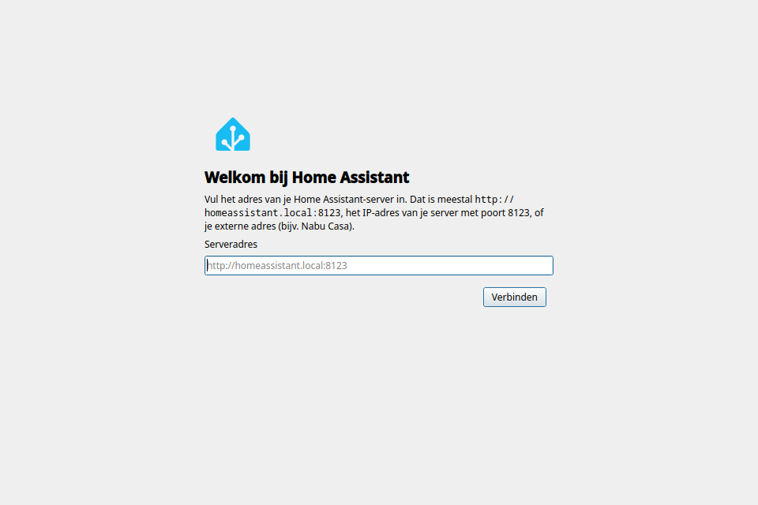
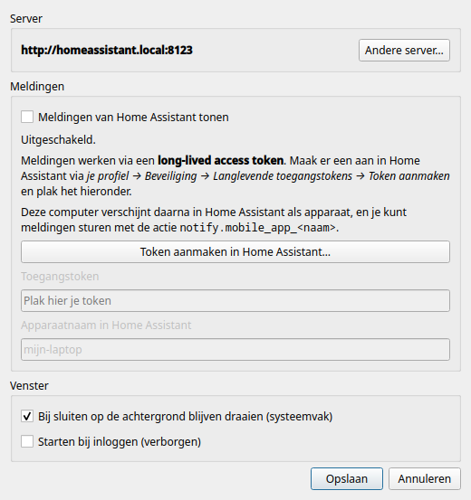

<div align="center">


# Home Assistant voor Linux

**Je Home Assistant-dashboard als echte desktop-app — met meldingen op je bureaublad.**

[](../../releases/latest)




</div>

---

## ✨ Wat kan het?

| | |
|---|---|
| 🏠 **Eigen venster** | De volledige Home Assistant-interface, zonder browsertabs en adresbalk. |
| 🚀 **Eenvoudig instellen** | Vul je serveradres in; de app controleert of er echt Home Assistant draait. |
| 🔐 **Blijft ingelogd** | Eén keer inloggen, ook na herstarten. |
| 🔔 **Meldingen** | Stuur meldingen vanuit automatiseringen naar je pc, net als naar je telefoon. Klik erop en de juiste pagina opent. |
| 📥 **Systeemvak** | Draait op de achtergrond door, zodat je geen melding mist. Kan meestarten bij inloggen. |
| 🔒 **Lokaal en veilig** | Meldingen komen rechtstreeks van je eigen server, niet via een cloud. Je token staat in de keyring (KWallet / GNOME Keyring). |
| 🔁 **Robuust** | Server even weg of laptop uit de slaapstand? De app verbindt vanzelf opnieuw. |

## 📦 Installeren

1. Download het nieuwste `.rpm`-bestand onder **[Releases](../../releases/latest)**.
2. Installeer het:
   ```sh
   sudo dnf install ./ha-desktop-*.noarch.rpm
   ```
3. Start **Home Assistant** vanuit het menu.

Verwijderen: `sudo dnf remove ha-desktop`

<details>
<summary><b>Geen Fedora 44?</b> Installeren vanuit de broncode</summary>

<br>

Je hebt Python 3 en PySide6 met QtWebEngine nodig (Fedora: `python3-pyside6`,
Arch: `pyside6`, Debian/Ubuntu: de `python3-pyside6.*`-pakketten of `pip install PySide6`).

```sh
git clone https://github.com/Svenvdp21/ha-desktop.git
cd ha-desktop
./install.sh            # zet de app in je menu
./install.sh --remove   # weer verwijderen
```

Laat de map daarna staan: de app draait vanuit deze map.
</details>

## 🚀 Eerste keer

1. Vul het adres van je server in, bijvoorbeeld `http://homeassistant.local:8123` of je
   Home Assistant Link-adres. Gebruik je een zelfondertekend certificaat, dan vraagt de
   app of je het wilt vertrouwen.
2. Log in zoals je gewend bent. Vink **Ingelogd blijven** aan.
3. Wil je meldingen? Volg de stappen hieronder, of kies *Overslaan* en doe het later.

## 🔔 Meldingen instellen



Meldingen werken via een **token**: een soort wachtwoord waarmee de app zelf met je
server praat.

1. Open in de app de instellingen (`Ctrl+,`) en klik op
   **Token aanmaken in Home Assistant…**
2. Scrol **helemaal naar beneden** naar *Langdurige toegangstokens* en klik op
   **Token aanmaken**.
3. Kopieer het token meteen (je ziet het maar één keer), plak het in de app en klik op
   **Opslaan**.

Je pc staat nu als apparaat in Home Assistant. Stuur een melding met:

```yaml
action: notify.mobile_app_mijn_laptop   # jouw apparaatnaam
data:
  title: Deurbel
  message: Er staat iemand voor de deur
  data:
    url: /lovelace/cameras   # optioneel: opent bij klikken
```

<br clear="right">

## ⌨️ Sneltoetsen

| Toets | Actie |
|---|---|
| `F5` / `Ctrl+R` | Herladen |
| `Alt+←` / `Alt+→` | Terug / vooruit |
| `Alt+Home` | Startpagina |
| `F11` | Volledig scherm |
| `Ctrl +` / `Ctrl -` / `Ctrl 0` | Zoomen |
| `Ctrl+,` | Instellingen |
| `Ctrl+Q` | Afsluiten (sluiten met het kruisje laat de app in het systeemvak draaien) |

Instellingen vind je ook onder de rechtermuisknop en in het systeemvak.

## ❓ Problemen oplossen

<details>
<summary><b>"Geen verbinding met Home Assistant"</b></summary>

Controleer of het adres klopt en of je server aanstaat. De app probeert het elke 10
seconden opnieuw. Werkt het adres in je browser wel? Kies dan *Instellingen → Andere
server…* en vul het opnieuw in.
</details>

<details>
<summary><b>Ik krijg geen meldingen</b></summary>

- Kijk in de instellingen: er moet **● Verbonden** staan.
- De app moet draaien (eventueel alleen in het systeemvak).
- Staat er *Token geweigerd*? Maak een nieuw token aan en plak het opnieuw.
- Check in Home Assistant onder *Instellingen → Apparaten → Mobile App* of je pc erbij staat.
</details>

<details>
<summary><b>Ik moet steeds opnieuw inloggen</b></summary>

Vink op de loginpagina **Ingelogd blijven** aan.
</details>

<details>
<summary><b>Waar staan mijn gegevens?</b></summary>

| Wat | Waar |
|-----|------|
| Instellingen | `~/.config/ha-desktop/config.json` |
| Token | Keyring, of anders `~/.config/ha-desktop/token` (alleen voor jou leesbaar) |
| Login en cookies | `~/.local/share/ha-desktop/webengine` |
| Cache | `~/.cache/ha-desktop` |
</details>

## 🛠️ Voor ontwikkelaars

```sh
python3 -m ha_desktop --debug                                       # starten vanuit de broncode
QT_QPA_PLATFORM=offscreen python3 -m unittest discover -s tests -v  # tests
./packaging/build-rpm.sh                                            # RPM bouwen -> dist/
```

De tests draaien tegen een nagebootste Home Assistant (`tests/fake_ha.py`): server-check,
apparaatregistratie, het push-kanaal en opnieuw verbinden.

Nieuwe versie uitbrengen: verhoog `__version__` in `ha_desktop/__init__.py`, bouw de RPM
en maak een release aan. Bestaande installaties werken bij met `sudo dnf install` van de
nieuwe RPM.

Het meldingsprotocol (`mobile_app`-registratie met `push_websocket_channel`) volgt
dezelfde aanpak als [go-hass-agent](https://github.com/joshuar/go-hass-agent). Wil je ook
sensoren van je pc in Home Assistant (CPU, batterij, …)? Dan kun je go-hass-agent ernaast
gebruiken; zet meldingen dan in maar één van beide aan.

---

<sub>Dit is geen officieel Home Assistant-project. Naam en logo zijn merken van de
[Open Home Foundation](https://www.openhomefoundation.org/) en worden hier alleen gebruikt
voor privé, niet-commercieel gebruik.</sub>
